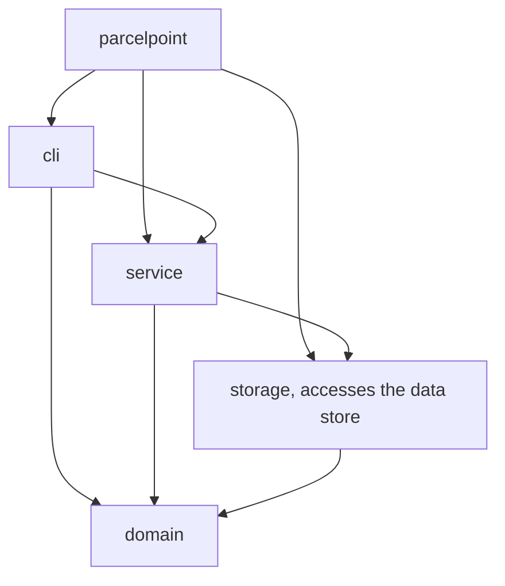
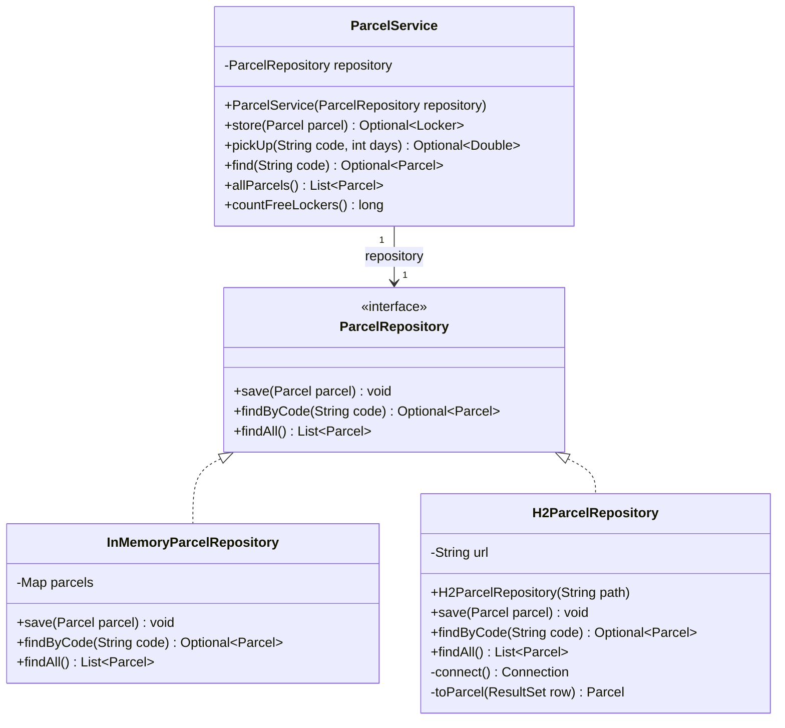
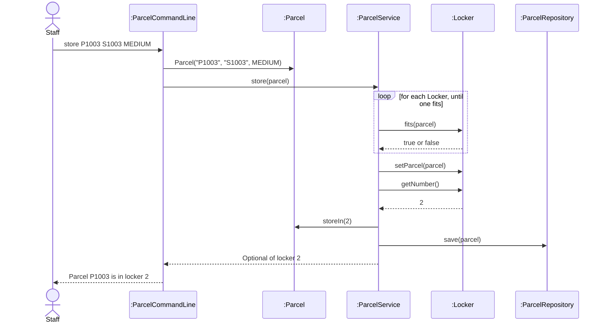

# Lab Report, Designing the Data Management Layer with H2

Repository URL: https://github.com/WRNT-P/itcs382-h2-lab

## Tools

| Item | Version or name |
| --- | --- |
| JDK | Temurin 25.0.4.1 |
| Maven | 3.10.0 |
| IDE | Visual Studio Code 1.145.2 |
| AI tool and exact model, if you used one | Claude Opus 5.5 |

## Part 0. From a store in memory to H2

Commit of the starter, before any change: abceff7

0.3 Your prediction for `staff`, written before the second run:

I think `staff` will show nothing and all 3 lockers will be free, because the parcels are only kept while the program is running.

Output of the second run, for `staff` and `quit`:

```text
> staff
Free lockers: 3
> quit
```

State in one sentence where you think the parcels of the first run were kept.

They were kept in a Map inside InMemoryParcelRepository, which is only in memory, so they were gone once the program ended.

0.5 The line of Main that you would change to keep the parcels somewhere else:

```java
ParcelRepository repository = new InMemoryParcelRepository();
```

0.6 Commit of the switch to H2: ca16f64

0.7 Output of `SELECT * FROM PARCEL;` after you stored two parcels:

```text
sql> SELECT * FROM PARCEL;
CODE  | STUDENT_ID | PARCEL_SIZE | STATUS | LOCKER_NUMBER
P1001 | S1001      | SMALL       | STORED | 1
P1002 | S1002      | LARGE       | STORED | 3
(2 rows, 14 ms)
```

0.8 Explain why ParcelPoint could not start while the H2 Shell was open, and identify the class that wrote the message `Cannot create the PARCEL table`.

The H2 Shell still had the database open. H2 is embedded, so whichever program opens it first locks parcelpoint.mv.db, and a second program can't get in (the error says `The file is locked`). ParcelPoint tries to connect in the H2ParcelRepository constructor to create the table, so it failed right at startup. The message `Cannot create the PARCEL table` comes from H2ParcelRepository, not from H2. Its constructor catches the SQLException and throws an IllegalStateException with that text, and the stack trace points to `H2ParcelRepository.<init>`.

0.9 Explain why `staff` shows no parcel while `find` shows each one, and why all three lockers look free.

`find` uses findByCode, which actually runs a SELECT on the PARCEL table, so it finds the parcels. `staff` uses findAll, but in the starter findAll just returns `List.of()` without asking the database, so nothing is listed. The lockers look free for the same reason. When the program starts, the ParcelService constructor calls `findAll()` to put the waiting parcels back into their lockers, and since it gets an empty list, every locker stays empty.

0.11 Your findAll method:

```java
    @Override
    public List<Parcel> findAll() {
        String sql = "SELECT * FROM PARCEL ORDER BY CODE";
        List<Parcel> parcels = new ArrayList<>();
        try (Connection connection = connect();
             PreparedStatement statement = connection.prepareStatement(sql)) {
            try (ResultSet row = statement.executeQuery()) {
                while (row.next()) {
                    parcels.add(toParcel(row));
                }
            }
        } catch (SQLException e) {
            throw new IllegalStateException("Cannot read the parcels", e);
        }
        return parcels;
    }
```

Commit that adds findAll: 0be8e97

0.12 Output of `SELECT * FROM PARCEL;` after the pickup:

```text
sql> SELECT * FROM PARCEL;
CODE  | STUDENT_ID | PARCEL_SIZE | STATUS    | LOCKER_NUMBER
P1001 | S1001      | SMALL       | PICKED_UP | null
P1002 | S1002      | LARGE       | STORED    | 3
(2 rows, 13 ms)
```

0.13 Optional. Describe what `find P9999'OR'1'='1` showed while the SQL was joined from strings, and what it showed after you put the placeholder back.

With the SQL built from strings, `find P9999'OR'1'='1` printed `P1001, S1001, SMALL, PICKED_UP` even though no parcel has that code. My quotes ended the string early and added `OR '1'='1'`, which is true for every row, so every row came back and findByCode showed the first one. After putting the `?` back, the same input gave `No parcel with code P9999'OR'1'='1`, because H2 now treats the whole input as one value to compare with CODE.

## Part A. Model the design

A1 Complete the flowchart with one node for each package and one arrow for each dependency, from the package that uses to the package that is used. Mark the package that accesses the data store.



State whether cli depends on storage, and explain why.

No. ParcelCommandLine only imports from domain and service, never from storage. It gets parcels by calling ParcelService, and only ParcelService talks to the repository. So we can swap the data store without touching cli.

A2 Complete the class diagram of the data management layer with ParcelService, the interface ParcelRepository with its three operations, and the two classes that implement it.



A3 Draw a sequence diagram for the command `store P1003 S1003 MEDIUM`, from the staff member to the repository. Show each message as an operation of the class that receives it.



Explain why the last lifeline is the interface ParcelRepository rather than H2ParcelRepository.

ParcelService only knows its field as a ParcelRepository and never mentions H2ParcelRepository, so `save` is sent to the interface. Which class is actually behind it is decided in Main. That way the diagram stays correct whether we run with the in-memory store or H2, and it doesn't show a dependency that ParcelService doesn't really have.

## Part B. Design questions

1. Identify the files that you changed to move from the store in memory to H2, and explain why no other class had to change. Use the terms of this course.

2. The PARCEL table stores the size of a parcel as SMALL, MEDIUM or LARGE rather than as 1, 2 or 3. Identify the type of connascence between ParcelSize and the table in each case, and explain which one is weaker.

3. Project Phase 2 asks for a data store that needs no separate server. Explain why an embedded database such as H2 meets this rule, and describe the limit of an embedded database that Step 0.8 showed.

4. State the data store that you would choose for your Project Phase 2 team, files or an embedded database, the requirement that drives the choice, and the package that will access it.

## AI usage declaration

| AI tool and exact model | Date | Purpose | Files or answers it produced or changed | How you checked its output |
| --- | --- | --- | --- | --- |
| | | | | |
